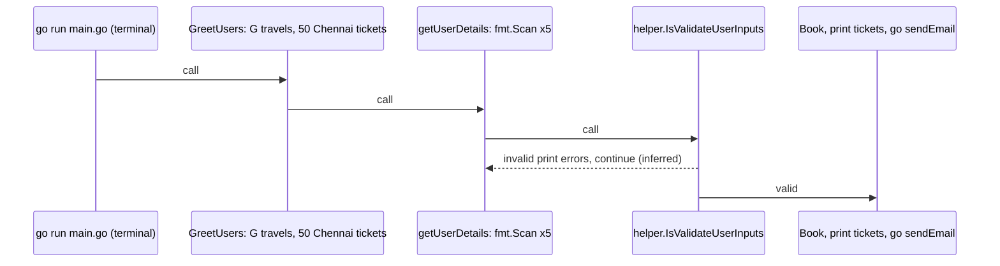
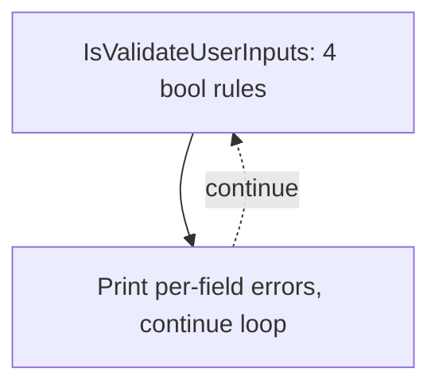

# GoApp Handbook — G travels CLI Ticket Booking in Go
*A practical engineering walkthrough of the G travels CLI ticket-booking app for new Go learners and maintainers*
**Scope:** repository · **Audience:** technical handbook · **Source:** `Gopinathv19/GoApp` @ `cfc0167`

## 1. Project overview

Read this as a file-by-file walkthrough: start in main.go for GreetUsers, the getUserDetails loop, UserData, and the ticket counters; then read helper/helper.go for IsValidateUserInputs. Follow one successful booking end to end, then use the known-issues checklist before extending anything.[^C10][^C14][^C17][^C25]

**Problem it solves.** GoApp is a tiny beginner-friendly CLI ticket system for G travels: it greets a user, offers 50 Chennai tickets, repeatedly collects booking details, validates them, confirms a booking, and simulates email confirmation — all in the terminal with no server or database.[^C1][^C10][^C27]

- Purpose: a CLI ticket-booking app — 'The command line Application for the ticket Booking'.[^C1]
- Module: BookingApplication, go 1.22.1 (go.mod:1-4); dependency graph is just main.go → helper.[^C2]
- Brand and inventory: travelsName is 'G travels' with ticketsAvailable = 50 Chennai tickets.[^C5][^C6]
- Interface: terminal only — go run main.go, stdin prompts via fmt.Scan; no HTTP routes detected.[^C38]
- Files: main.go (package main) plus helper/helper.go (package helper, strings only).[^C3][^C4]

## 2. Architecture

A two-file Go application: package main in main.go drives the terminal flow and package helper in helper/helper.go validates inputs. main.go imports BookingApplication/helper, fmt, and time, while helper imports only strings. There are no HTTP routes and no external module dependencies beyond the Go standard library.[^C3][^C4][^C10][^C17]

| Layer | Responsibility | Where | Evidence |
| --- | --- | --- | --- |
| CLI / entrypoint | Owns G travels greeting, input loop, booking state, confirmation, ticket display, and simulated email dispatch. | [`main.go`](https://github.com/Gopinathv19/GoApp/blob/cfc0167479bc110fca008bdd9084aa3d8a82d55e/main.go) | — |
| Validation helper | Owns IsValidateUserInputs, the standalone input-rule checks used by main. | [`helper/helper.go`](https://github.com/Gopinathv19/GoApp/blob/cfc0167479bc110fca008bdd9084aa3d8a82d55e/helper/helper.go) | — |

## 3. Directory guide

| Path | Purpose | Start here | Evidence |
| --- | --- | --- | --- |
| [`go.mod`](https://github.com/Gopinathv19/GoApp/blob/cfc0167479bc110fca008bdd9084aa3d8a82d55e/go.mod) | Declares module BookingApplication and go 1.22.1; run the app with go run main.go. | — | [^C2][^C38] |
| [`README.md`](https://github.com/Gopinathv19/GoApp/blob/cfc0167479bc110fca008bdd9084aa3d8a82d55e/README.md) | States the repo purpose: The command line Application for the ticket Booking. | — | [^C1] |
| [`main.go`](https://github.com/Gopinathv19/GoApp/blob/cfc0167479bc110fca008bdd9084aa3d8a82d55e/main.go) | Package main entrypoint: GreetUsers, booking loop, UserData, counters, getTickets, getFirstNames, sendEmail. | — | [^C3][^C5][^C10] |
| [`helper/`](https://github.com/Gopinathv19/GoApp/blob/cfc0167479bc110fca008bdd9084aa3d8a82d55e/helper/) | Contains 1 source file; helper/helper.go holds IsValidateUserInputs. | — | [^C4][^C17] |
| [`helper/helper.go`](https://github.com/Gopinathv19/GoApp/blob/cfc0167479bc110fca008bdd9084aa3d8a82d55e/helper/helper.go) | Package helper validation using only strings; returns four booleans to main. | — | [^C4][^C17][^C20] |

## 4. Functional workflows

### Startup and input loop

main calls GreetUsers once, printing the G travels welcome with total and remaining Chennai tickets, then enters the booking loop and calls getUserDetails on every iteration.[^C10][^C11][^C16]

1. Run go run main.go; main calls GreetUsers() once before the loop.[^C10][^C11]
2. Each iteration calls getUserDetails, which prompts and fmt.Scans five values.[^C14][^C16]
3. main calls helper.IsValidateUserInputs with the inputs plus remainingTicketsAvailable.[^C22]
4. Likely loop forever: there is no break or sold-out exit, inferred from the loop continuing after both success and failure paths.[^C31][^C32]

#### Startup and input loop

*Dashed edges (1) are inferred, not directly observed in code.*
<details><summary>Diagram sources</summary>

- go run main.go (terminal): [`main.go`](https://github.com/Gopinathv19/GoApp/blob/cfc0167479bc110fca008bdd9084aa3d8a82d55e/main.go)
- GreetUsers: G travels, 50 Chennai tickets: [`main.go`](https://github.com/Gopinathv19/GoApp/blob/cfc0167479bc110fca008bdd9084aa3d8a82d55e/main.go)
- getUserDetails: fmt.Scan x5: [`main.go`](https://github.com/Gopinathv19/GoApp/blob/cfc0167479bc110fca008bdd9084aa3d8a82d55e/main.go)
- helper.IsValidateUserInputs: [`helper/helper.go`](https://github.com/Gopinathv19/GoApp/blob/cfc0167479bc110fca008bdd9084aa3d8a82d55e/helper/helper.go)
- Book, print tickets, go sendEmail: [`main.go`](https://github.com/Gopinathv19/GoApp/blob/cfc0167479bc110fca008bdd9084aa3d8a82d55e/main.go)

</details>

### Successful booking flow

When all four validation booleans are true, the booking updates counters, builds a UserData via userBookingConfirmation, stores it through putUserDetailsInSlices, prints via getTickets, and fires go sendEmail.[^C23][^C25][^C27][^C30]

1. Gate: isValidUserName && isValidEmail && isValidPhnNumber && isValidTicketNumber must all hold.[^C23][^C24]
2. Counters: ticketsSaled += ticketsNeedtoBeBooked, then remainingTicketsAvailable -= ticketsSaled (cumulative bug).[^C24][^C33]
3. Record: userBookingConfirmation builds UserData; putUserDetailsInSlices wraps it in a new 1-element slice.[^C25][^C26]
4. Display: getTickets prints thank-you, remaining count, first names from getFirstNames, and full userDetails.[^C27][^C28]
5. Async: go sendEmail(emailAddress, ticketsNeedtoBeBooked) sleeps 10s, then prints the confirmation.[^C29][^C30]

#### Successful booking flow
```mermaid
sequenceDiagram
  participant n1 as All 4 validation bools true
  participant n2 as ticketsSaled += need; remaining -= ticketsSaled (bug)
  participant n3 as userBookingConfirmation -#gt; UserData; putUserDetailsInSlices
  participant n4 as getTickets + getFirstNames print summary
  participant n5 as go sendEmail: sleep 10s, print confirmation
  n1->>n2: call
  n2->>n3: call
  n3->>n4: call
  n4->>n5: call
```
<details><summary>Diagram sources</summary>

- All 4 validation bools true: [`main.go`](https://github.com/Gopinathv19/GoApp/blob/cfc0167479bc110fca008bdd9084aa3d8a82d55e/main.go)
- ticketsSaled += need; remaining -= ticketsSaled (bug): [`main.go`](https://github.com/Gopinathv19/GoApp/blob/cfc0167479bc110fca008bdd9084aa3d8a82d55e/main.go)
- userBookingConfirmation -> UserData; putUserDetailsInSlices: [`main.go`](https://github.com/Gopinathv19/GoApp/blob/cfc0167479bc110fca008bdd9084aa3d8a82d55e/main.go)
- getTickets + getFirstNames print summary: [`main.go`](https://github.com/Gopinathv19/GoApp/blob/cfc0167479bc110fca008bdd9084aa3d8a82d55e/main.go)
- go sendEmail: sleep 10s, print confirmation: [`main.go`](https://github.com/Gopinathv19/GoApp/blob/cfc0167479bc110fca008bdd9084aa3d8a82d55e/main.go)

</details>

### Validation failure path

IsValidateUserInputs returns four booleans; if any is false, main prints a per-field error for each failing rule and continues the loop with no booking recorded.[^C18][^C20][^C21][^C31]

1. Rules: name len > 2 each, email contains @, phone len == 10; ticket rule covered in the rules table below.[^C18][^C20][^C21]
2. On failure, main prints per-field error messages and continues to the next iteration.[^C31]

#### Validation failure path

*Dashed edges (1) are inferred, not directly observed in code.*
<details><summary>Diagram sources</summary>

- IsValidateUserInputs: 4 bool rules: [`helper/helper.go`](https://github.com/Gopinathv19/GoApp/blob/cfc0167479bc110fca008bdd9084aa3d8a82d55e/helper/helper.go)
- Print per-field errors, continue loop: [`main.go`](https://github.com/Gopinathv19/GoApp/blob/cfc0167479bc110fca008bdd9084aa3d8a82d55e/main.go)

</details>

## 6. Data flow

Startup prints the G travels greeting, then the loop collects five values with fmt.Scan, validates them against remainingTicketsAvailable, updates counters on success, builds a UserData record, prints the ticket summary, and launches sendEmail concurrently. Invalid input prints field-specific errors and continues to the next loop iteration without changing a booking.[^C11][^C14][^C22][^C23][^C24][^C25][^C26][^C27]

### Data models

| Model | Purpose | Where | Evidence |
| --- | --- | --- | --- |
| UserData | Central booking record built by userBookingConfirmation from the five user inputs. | — | [^C9][^C25] |
| Ticket counters | Track the fixed Chennai ticket pool and cumulative sales for G travels. | — | [^C6][^C7][^C8][^C24] |

## 7. Technology stack

| Technology | Category | Role | Evidence |
| --- | --- | --- | --- |
| Go 1.22.1 | Language / runtime | Declared in go.mod for module BookingApplication; the app runs as a terminal program. | [^C2] |
| fmt (Scan / Print) | CLI I/O | Prompts, input scanning, greetings, summaries, and error messages in main.go. | [^C3][^C14] |
| strings | Validation | Used only in helper/helper.go, for strings.Contains(emailAddress, "@"). | [^C4][^C20] |
| time + goroutine | Concurrency / timing | sendEmail sleeps 10 * time.Second to simulate async email delivery, launched with go. | [^C3][^C29][^C40] |

## 8. Design decisions

### Two-file layering: main.go owns CLI flow, helper/ owns validation

main.go imports BookingApplication/helper; helper only uses strings.[^C3][^C4]

### Package-level ticket counters with const total plus mutable remaining

ticketsAvailable=50 is constant and remainingTicketsAvailable=50 is a package-level var.[^C6][^C7]

### UserData struct centralises the booking record

The struct and userBookingConfirmation constructor carry all five booking fields together.[^C9][^C25]

### Fire-and-forget email via goroutine plus 10s sleep to simulate async delivery

go sendEmail is launched without waiting and sendEmail sleeps 10 * time.Second before printing.[^C29][^C30]

### (inferred) Remaining tickets subtract cumulative ticketsSaled (bug, needs fix)

Likely unintended: remaining -= ticketsSaled subtracts the cumulative total instead of only the current booking.[^C24][^C33]

## 9. Presentation guide

### Hook: a complete booking in two files

- G travels sells 50 Chennai tickets from a single terminal program — no server, no database.
- Everything a new Go learner needs is here: structs, slices, functions, a package, and a goroutine.

### Live walkthrough

- Run go run main.go, book 2 tickets with valid inputs, and watch the summary print instantly.
- Point at the prompt again appearing before the ~10s sendEmail confirmation lands — that gap is the goroutine.

### The one-line bug

- Book twice on a whiteboard: remaining -= ticketsSaled subtracts the cumulative total, so the second booking over-deducts.
- Ask the audience for the fix before revealing: subtract only ticketsNeedtoBeBooked.

### Roadmap pitch

- Close with the improvement checklist: sold-out exit, WaitGroup, persistent bookings slice, real tests.
- Each fix is small, local, and maps to one function already named in this handbook.

## 10. Q&A preparation

**Q: How do I run GoApp?**

Run go run main.go from the repository root. go.mod declares module BookingApplication with go 1.22.1, and interaction is entirely through terminal fmt.Scan prompts; there are no HTTP routes.[^C2][^C38]

**Q: What makes an input valid?**

Four rules in helper.IsValidateUserInputs: both names longer than 2 characters, tickets > 0 and <= remainingTicketsAvailable, email contains @, and phone length exactly 10.[^C18][^C20][^C21]

**Q: Why does the remaining-ticket count drop too fast?**

Likely a bug, stated as inferred: on success main does ticketsSaled += ticketsNeedtoBeBooked then remainingTicketsAvailable -= ticketsSaled, so the cumulative sold total is subtracted every time instead of just the current booking.[^C24][^C33]

**Q: Why does the first-names list only show the latest user?**

Because putUserDetailsInSlices creates a fresh []UserData and appends only the single current UserData each booking, so getFirstNames — likely, inferred — only ever sees the current user.[^C26][^C28][^C35]

**Q: Will the email confirmation always print?**

It might not. sendEmail is launched with go and sleeps 10 seconds; nothing waits for it, so — inferred — ending or interrupting the program first can lose the confirmation.[^C29][^C30][^C34]

**Q: Does the app exit when tickets sell out?**

No. main has no break, return, or os.Exit inside the loop, so sold-out never terminates the program; invalid or zero-ticket iterations just continue.[^C32]

## Getting started

1. Confirm a Go toolchain compatible with go.mod (module BookingApplication, go 1.22.1).
   ```sh
   go version
   ```[^C2]
2. From the repository root, run the CLI; no routes, server, or build config are involved.
   ```sh
   go run main.go
   ```[^C38]
3. Expect the G travels welcome showing 50 total Chennai tickets and the remaining count.
   ```sh
   (terminal output)
   ```[^C10][^C11]
4. Enter first name, second name, email, phone, and ticket count when prompted; validation runs next.
   ```sh
   (answer each fmt.Scan prompt)
   ```[^C14][^C22]
5. Read the immediate ticket summary, then wait for the delayed sendEmail confirmation line.
   ```sh
   (wait ~10s after a valid booking)
   ```[^C27][^C29]

## Open questions

- Exact run-command variant (go run main.go vs go run .) is not documented in the repo; go run main.go is the brief-agreed command.
- Whether phone validation should allow non-digit characters or varied lengths is unspecified.
- Intended sold-out behaviour is unclear because the loop has no exit condition.
- The intended purpose of displaying fullNames is unclear; it is collected but never printed.
- No tests, CI, or deployment configuration were available to describe.

## Evidence

[^C1]: **Verified** · [README.md:1-3](https://github.com/Gopinathv19/GoApp/blob/cfc0167479bc110fca008bdd9084aa3d8a82d55e/README.md#L1-L3) — Repo purpose is a CLI ticket-booking app described as `The command line Application for the ticket Booking`
[^C2]: **Verified** · [go.mod:1-4](https://github.com/Gopinathv19/GoApp/blob/cfc0167479bc110fca008bdd9084aa3d8a82d55e/go.mod#L1-L4) — `go.mod` declares module `BookingApplication` requiring `go 1.22.1`
[^C3]: **Verified** · [main.go:1-7](https://github.com/Gopinathv19/GoApp/blob/cfc0167479bc110fca008bdd9084aa3d8a82d55e/main.go#L1-L7) — `main.go` is package `main` entrypoint importing `BookingApplication/helper`, `fmt`, and `time`
[^C4]: **Verified** · [helper/helper.go:1-5](https://github.com/Gopinathv19/GoApp/blob/cfc0167479bc110fca008bdd9084aa3d8a82d55e/helper/helper.go#L1-L5) — `helper/helper.go` is package `helper` importing only `strings`
[^C5]: **Verified** · [main.go:15](https://github.com/Gopinathv19/GoApp/blob/cfc0167479bc110fca008bdd9084aa3d8a82d55e/main.go#L15) — `travelsName` constant is `"G travels"` branding used in greeting
[^C6]: **Verified** · [main.go:10](https://github.com/Gopinathv19/GoApp/blob/cfc0167479bc110fca008bdd9084aa3d8a82d55e/main.go#L10) — `ticketsAvailable` constant is `50` representing total Chennai tickets
[^C7]: **Verified** · [main.go:12](https://github.com/Gopinathv19/GoApp/blob/cfc0167479bc110fca008bdd9084aa3d8a82d55e/main.go#L12) — `remainingTicketsAvailable` is package-level `uint` initialized to `50`
[^C8]: **Verified** · [main.go:13](https://github.com/Gopinathv19/GoApp/blob/cfc0167479bc110fca008bdd9084aa3d8a82d55e/main.go#L13) — `ticketsSaled` is package-level `uint` initialized to `0` accumulating sold count
[^C9]: **Verified** · [main.go:17-23](https://github.com/Gopinathv19/GoApp/blob/cfc0167479bc110fca008bdd9084aa3d8a82d55e/main.go#L17-L23) — `UserData` struct holds `firstName`, `secondName`, `email`, `phoneNumber`, `ticketsNeedtoBeBooked`
[^C10]: **Verified** · [main.go:75-79](https://github.com/Gopinathv19/GoApp/blob/cfc0167479bc110fca008bdd9084aa3d8a82d55e/main.go#L75-L79) — `GreetUsers` prints welcome with `travelsName`, `ticketsAvailable`, and `remainingTicketsAvailable`
[^C11]: **Verified** · [main.go:25-27](https://github.com/Gopinathv19/GoApp/blob/cfc0167479bc110fca008bdd9084aa3d8a82d55e/main.go#L25-L27) — `main` calls `GreetUsers()` once at startup before booking loop
[^C14]: **Verified** · [main.go:92-104](https://github.com/Gopinathv19/GoApp/blob/cfc0167479bc110fca008bdd9084aa3d8a82d55e/main.go#L92-L104) — `getUserDetails` prompts and `fmt.Scan`s `firstName`, `secondName`, `emailAddress`, `phoneNumber`, `ticketsNeedtoBeBooked`
[^C16]: **Verified** · [main.go:38](https://github.com/Gopinathv19/GoApp/blob/cfc0167479bc110fca008bdd9084aa3d8a82d55e/main.go#L38) — `main` calls `getUserDetails` each loop iteration and reassigns all six return values
[^C17]: **Verified** · [helper/helper.go:7](https://github.com/Gopinathv19/GoApp/blob/cfc0167479bc110fca008bdd9084aa3d8a82d55e/helper/helper.go#L7) — `IsValidateUserInputs` signature takes names, ticket count, email, phone, remaining and returns four `bool`s
[^C18]: **Verified** · [helper/helper.go:8](https://github.com/Gopinathv19/GoApp/blob/cfc0167479bc110fca008bdd9084aa3d8a82d55e/helper/helper.go#L8) — `IsValidateUserInputs` validates name as `len(firstName) > 2 && len(secondName) > 2`
[^C20]: **Verified** · [helper/helper.go:10](https://github.com/Gopinathv19/GoApp/blob/cfc0167479bc110fca008bdd9084aa3d8a82d55e/helper/helper.go#L10) — `IsValidateUserInputs` validates email via `strings.Contains(emailAddress, "@")`
[^C21]: **Verified** · [helper/helper.go:11-13](https://github.com/Gopinathv19/GoApp/blob/cfc0167479bc110fca008bdd9084aa3d8a82d55e/helper/helper.go#L11-L13) — `IsValidateUserInputs` validates phone as `len(phoneNumber) == 10`
[^C22]: **Verified** · [main.go:42](https://github.com/Gopinathv19/GoApp/blob/cfc0167479bc110fca008bdd9084aa3d8a82d55e/main.go#L42) — `main` invokes `helper.IsValidateUserInputs` with current inputs plus `remainingTicketsAvailable`
[^C23]: **Verified** · [main.go:44](https://github.com/Gopinathv19/GoApp/blob/cfc0167479bc110fca008bdd9084aa3d8a82d55e/main.go#L44) — Booking proceeds only if `isValidUserName && isValidEmail && isValidPhnNumber && isValidTicketNumber`
[^C24]: **Verified** · [main.go:45-46](https://github.com/Gopinathv19/GoApp/blob/cfc0167479bc110fca008bdd9084aa3d8a82d55e/main.go#L45-L46) — On success `ticketsSaled += ticketsNeedtoBeBooked` then `remainingTicketsAvailable -= ticketsSaled`
[^C25]: **Verified** · [main.go:107-117](https://github.com/Gopinathv19/GoApp/blob/cfc0167479bc110fca008bdd9084aa3d8a82d55e/main.go#L107-L117) — `userBookingConfirmation` builds a `UserData` value from the five user inputs
[^C26]: **Verified** · [main.go:119-123](https://github.com/Gopinathv19/GoApp/blob/cfc0167479bc110fca008bdd9084aa3d8a82d55e/main.go#L119-L123) — `putUserDetailsInSlices` creates a fresh `[]UserData` and appends the single `UserData`
[^C27]: **Verified** · [main.go:125-131](https://github.com/Gopinathv19/GoApp/blob/cfc0167479bc110fca008bdd9084aa3d8a82d55e/main.go#L125-L131) — `getTickets` prints thank-you, `remainingTicketsAvailable`, first names, and full `userDetails`
[^C28]: **Verified** · [main.go:81-90](https://github.com/Gopinathv19/GoApp/blob/cfc0167479bc110fca008bdd9084aa3d8a82d55e/main.go#L81-L90) — `getFirstNames` extracts `firstName` from each `UserData` into `callNames` slice
[^C29]: **Verified** · [main.go:133-138](https://github.com/Gopinathv19/GoApp/blob/cfc0167479bc110fca008bdd9084aa3d8a82d55e/main.go#L133-L138) — `sendEmail` sleeps `10 * time.Second` then prints ticket confirmation with email and count
[^C30]: **Verified** · [main.go:51-52](https://github.com/Gopinathv19/GoApp/blob/cfc0167479bc110fca008bdd9084aa3d8a82d55e/main.go#L51-L52) — `main` launches `go sendEmail(emailAddress, ticketsNeedtoBeBooked)` as a goroutine without waiting
[^C31]: **Verified** · [main.go:55-70](https://github.com/Gopinathv19/GoApp/blob/cfc0167479bc110fca008bdd9084aa3d8a82d55e/main.go#L55-L70) — Invalid input branch prints per-field error messages and `continue`s the loop
[^C32]: **Verified** · [main.go:35-71](https://github.com/Gopinathv19/GoApp/blob/cfc0167479bc110fca008bdd9084aa3d8a82d55e/main.go#L35-L71) — `main` has no `break`, `return`, or `os.Exit` inside loop so sold-out never terminates
[^C33]: *Inferred* · [main.go:45-46](https://github.com/Gopinathv19/GoApp/blob/cfc0167479bc110fca008bdd9084aa3d8a82d55e/main.go#L45-L46) — Remaining-ticket math is buggy because `remainingTicketsAvailable` subtracts cumulative `ticketsSaled` instead of just current booking
[^C34]: *Inferred* · [main.go:51-52](https://github.com/Gopinathv19/GoApp/blob/cfc0167479bc110fca008bdd9084aa3d8a82d55e/main.go#L51-L52) — `sendEmail` goroutine may not finish if program ends or is interrupted since nothing synchronizes it
[^C35]: *Inferred* · [main.go:119-123](https://github.com/Gopinathv19/GoApp/blob/cfc0167479bc110fca008bdd9084aa3d8a82d55e/main.go#L119-L123) — `getFirstNames` only sees current booking because `putUserDetailsInSlices` creates a new one-element slice each time
[^C38]: **Verified** · [main.go:92-104](https://github.com/Gopinathv19/GoApp/blob/cfc0167479bc110fca008bdd9084aa3d8a82d55e/main.go#L92-L104) — App is run via `go run main.go` using stdin `fmt.Scan` prompts; no HTTP routes exist
[^C40]: **Verified** · [main.go:133-138](https://github.com/Gopinathv19/GoApp/blob/cfc0167479bc110fca008bdd9084aa3d8a82d55e/main.go#L133-L138) — Concurrency model is single `go sendEmail` per booking with `time.Sleep` simulating email delay


---

*Handbook generated by GitFill from `Gopinathv19/GoApp` @ `cfc0167` (main). 40 claims recorded: 33 verified, 3 inferred, 4 unverified. Footnotes link each statement to the lines that support it.*
